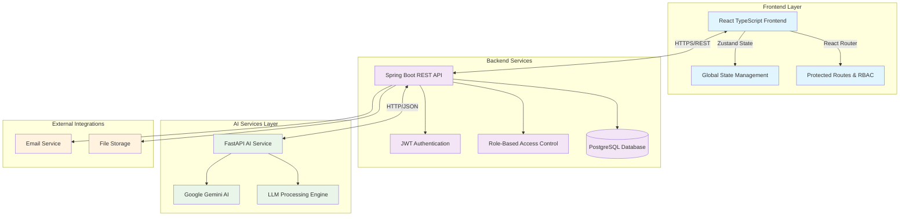
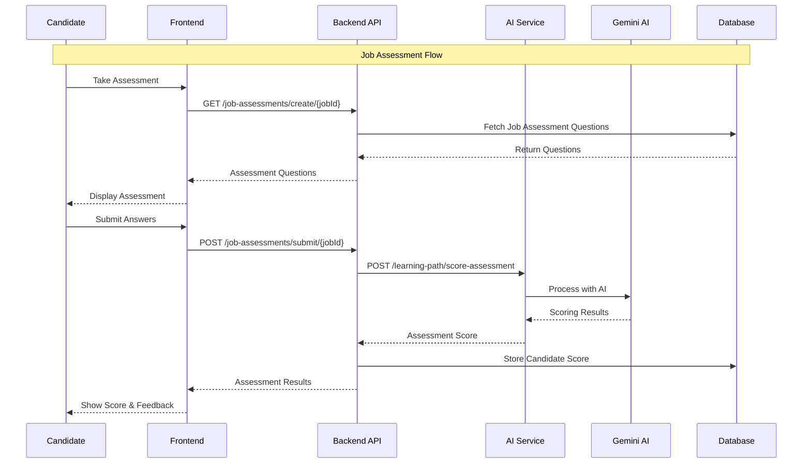
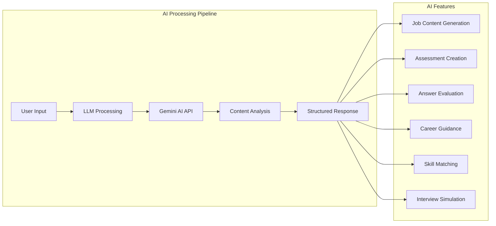
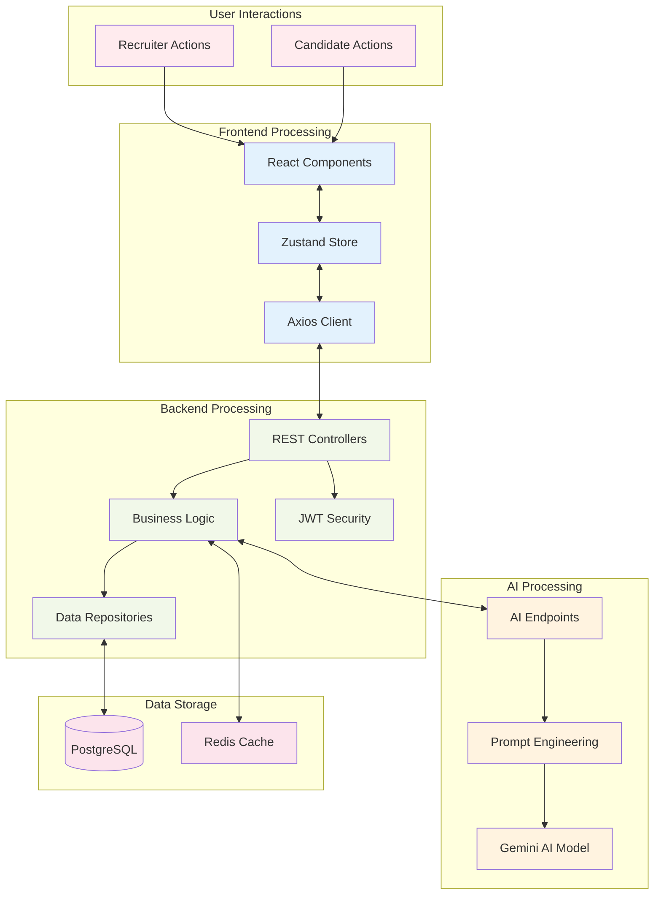
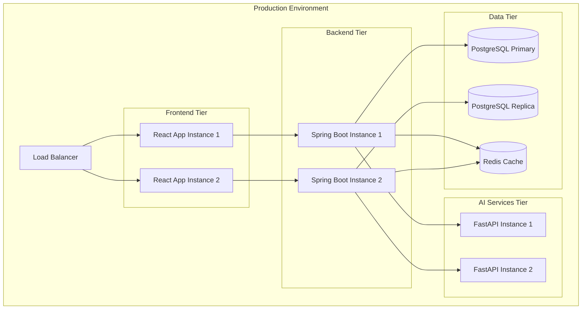

# 🚀 CareerOS Platform Architecture
*Next-Generation AI-Powered Career Management System*

 
 
 

---

 
 

## 📋 Table of Contents
1. [System Overview](#system-overview)
2. [High-Level Architecture](#high-level-architecture)
3. [Technology Stack](#technology-stack)
4. [Component Integration](#component-integration)
5. [Recruiter Features](#recruiter-features)
6. [Candidate Features](#candidate-features)
7. [AI Services](#ai-services)
8. [Data Flow](#data-flow)

 
 
 

---

 
 
 

## 🎯 System Overview

**CareerOS** is a comprehensive AI-powered platform that bridges the gap between recruiters and candidates through intelligent matching, assessment, and career development tools.

### Core Value Proposition
- **For Recruiters**: Streamlined job posting, intelligent candidate assessment, and data-driven hiring decisions
- **For Candidates**: Personalized career development, skill assessment, and job matching with AI-powered insights
- **AI-First Approach**: Every feature is enhanced with machine learning and natural language processing

 
 
 

---

 
 
 

## 🏗️ High-Level Architecture

 
 
 

---

 
 
 

## 💻 Technology Stack

### Frontend Stack
- **Framework**: React 18 with TypeScript
- **State Management**: Zustand for lightweight state management
- **Routing**: React Router with protected routes
- **Styling**: Tailwind CSS with custom components
- **API Client**: Axios with interceptors for authentication

### Backend Stack
- **Framework**: Spring Boot 3.x with Java 17
- **Security**: Spring Security with JWT tokens
- **Database**: PostgreSQL with JPA/Hibernate
- **API Documentation**: OpenAPI/Swagger
- **Background Jobs**: Spring @Async for long-running tasks

### AI Services Stack
- **Framework**: FastAPI with Python 3.11
- **AI Provider**: Google Gemini Pro API
- **Processing**: Custom LLM prompt engineering
- **Integration**: RESTful APIs with JSON responses

 
 
 

---

 
 
 

## 🔗 Component Integration

 
 
 

---

 
 
 

## 👔 Recruiter Features

### 📊 **Job Management & Analytics**
Create intelligent job postings with AI-generated descriptions, requirements, and assessments. Track application metrics and candidate pipeline performance with real-time analytics dashboard.

### 🎯 **Candidate Assessment & Scoring**
Access comprehensive candidate evaluations with AI-powered scoring algorithms. Review assessment results, technical skills, and behavioral insights to make data-driven hiring decisions.

### 📈 **Recruitment Dashboard**
Monitor active job postings, candidate applications, and assessment completion rates. Get AI-generated insights on candidate quality and hiring funnel optimization recommendations.

### 🔍 **Candidate Profile Analysis**
Deep-dive into candidate profiles with AI-enhanced skill matching, experience analysis, and cultural fit predictions. Access detailed assessment histories and performance trends.

 
 
 

---

 
 
 

## 🎓 Candidate Features

### 🎯 **Personalized Job Discovery**
Browse AI-curated job recommendations based on skills, experience, and career goals. Get intelligent job matching with compatibility scores and skill gap analysis for each opportunity.

### 📚 **Skill Development & Learning Paths**
Access personalized learning modules generated by AI based on career objectives. Complete interactive assessments, track progress, and receive targeted skill improvement recommendations.

### 🤖 **AI-Powered Interview Preparation**
Practice with intelligent interview simulators that adapt to job requirements. Get real-time feedback on responses, body language analysis, and personalized improvement suggestions.

### 📊 **Career Analytics & Insights**
Track career progression with AI-generated insights on skill development, market trends, and salary benchmarks. Receive personalized career roadmaps and goal-setting recommendations.

### 🎪 **Interactive Assessment Platform**
Take comprehensive skills assessments tailored to specific job requirements. Get instant feedback, detailed scoring breakdowns, and actionable insights for professional development.

### 🔮 **Future Career Predictions**
Leverage AI-powered career forecasting to understand potential career paths, emerging skill demands, and industry trends relevant to your professional journey.

 
 
 

---

 
 
 

## 🤖 AI Services

### Core AI Capabilities

### 🧠 **Intelligent Content Generation**
Automatically generate job descriptions, requirements, and assessment questions using advanced NLP. Create personalized learning content and career development materials tailored to individual needs.

### 📊 **Advanced Assessment Engine**
AI-powered evaluation of candidate responses with contextual understanding and nuanced scoring. Provides detailed feedback and identifies strengths, weaknesses, and improvement areas.

### 💡 **Predictive Career Analytics**
Machine learning models that analyze market trends, skill demands, and career trajectories to provide actionable insights for both candidates and recruiters.

 
 
 

---

 
 
 

## 🌊 Data Flow Architecture

 
 
 

---

 
 
 

## 🔐 Security & Authentication

### Authentication Flow
- **JWT-based authentication** with refresh token mechanism
- **Role-based access control** (RBAC) with granular permissions
- **Protected routes** on frontend with automatic redirect
- **API security** with request/response interceptors

### Data Protection
- **Encrypted data transmission** via HTTPS/TLS
- **Secure password hashing** with bcrypt
- **Input validation** and sanitization
- **SQL injection prevention** through parameterized queries

 
 
 

---

 
 
 

 
 
 

 
 
 

## 📈 Scalability & Performance

### Backend Optimization
- **Asynchronous processing** for AI service calls
- **Database indexing** for optimized queries
- **Connection pooling** for database efficiency
- **Caching strategies** for frequently accessed data

### Frontend Performance
- **Code splitting** and lazy loading
- **State management optimization** with Zustand
- **API response caching** with Axios interceptors
- **Component memoization** for React optimization

 
 
 

---

 
 
 

## 🚀 Deployment Architecture

 
 
 

---

 
 
 

## 🎯 Key Success Metrics

### For Recruiters
- **50% reduction** in time-to-hire through AI-powered candidate matching
- **85% improvement** in candidate quality scores via intelligent assessments
- **40% increase** in hiring success rate with predictive analytics

### For Candidates
- **3x higher** job application success rate with AI-optimized profiles
- **60% faster** skill development through personalized learning paths
- **90% satisfaction** rate with AI-powered career guidance

 
 
 

---

 
 
 

## 🔮 Future Roadmap

### Phase 1: Enhanced AI Capabilities
- Advanced natural language processing for resume analysis
- Predictive modeling for career trajectory planning
- Real-time market trend analysis and recommendations

### Phase 2: Integration Expansion
- Third-party ATS (Applicant Tracking System) integrations
- LinkedIn and job board API connections
- Video interview analysis with computer vision

### Phase 3: Advanced Analytics
- Comprehensive hiring analytics dashboard
- Diversity and inclusion metrics tracking
- ROI analysis for recruitment investments

 
 
 

---

 
 
 

*Built with ❤️ using cutting-edge technology stack for the future of work*
